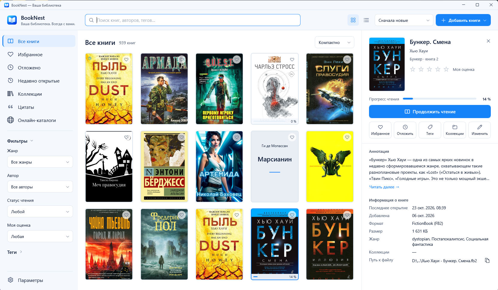
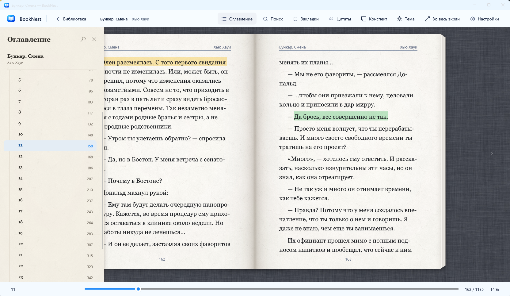
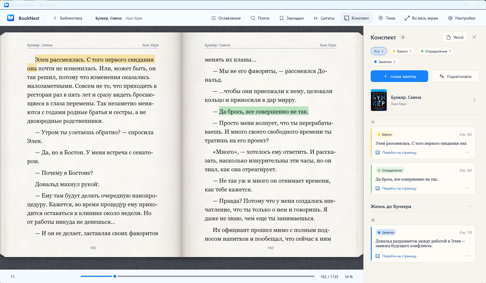

  

<h1 align="center">BookNest</h1>

  Ваша библиотека и читалка FB2, EPUB и PDF для Windows. 
  <a href="https://github.com/andyagent/BookNest-releases/releases/latest"><b>Скачать последнюю версию</b></a>

## Что умеет

**Библиотека**
- Импорт FB2, FB2.ZIP, EPUB и PDF: файлы, целые папки или перетаскиванием в окно. Прогресс и итог импорта видны в отдельной карточке, одинаковые книги не дублируются.
- Обложки плиткой или подробный список, мгновенный поиск по названию, автору, серии, жанрам и тегам.
- Связанные фильтры по жанру, автору, статусу чтения, оценке и тегам; избранное, отложенные, коллекции.

**Читалка**
- Разворот из двух страниц как в бумажной книге, точная пагинация, русские переносы, сглаженный текст.
- Светлая, сепия и тёмная темы, свой шрифт, кегль, поля, межстрочный интервал и интервал между абзацами, фото или текстура под книгой.
- EPUB читается как обычная книга: оглавление, сноски, ссылки и картинки сохраняются.
- Место чтения привязано к тексту: смена шрифта или размера окна его не сбивает.

**Учёба и конспекты**
- Цветные маркеры «Важно», «Определение», «Пример», «Вопрос» и цитаты прямо в тексте.
- Конспект книги: выделения и ваши заметки по главам, переход к месту в книге, экспорт в Word.
- Цитаты книги на боковой панели рядом с текстом: поиск, фильтры, копирование.

**Онлайн-каталоги**
- Поиск и загрузка книг в FB2 и EPUB из сетевых библиотек по стандарту OPDS: каталоги вы добавляете сами. Скачанная книга сразу попадает в библиотеку.

**Язык интерфейса**
- Русский или английский: выбирается в «Параметрах» или следует языку Windows. / The interface is available in English: choose it in Settings, or BookNest follows the Windows display language.

## Установка

1. Скачайте **BookNest-Setup-&lt;версия&gt;.exe** со [страницы последнего выпуска](https://github.com/andyagent/BookNest-releases/releases/latest) и запустите.
2. Установщик сам загрузит недостающие компоненты Microsoft (.NET Desktop Runtime 10 и Windows App Runtime 1.8), если их нет. Нужен интернет.
3. Новая версия ставится поверх прежней, библиотека и настройки сохраняются.

**Если Windows показывает «Система Windows защитила ваш компьютер»:** установщик пока не подписан сертификатом издателя. Нажмите **«Подробнее» → «Выполнить в любом случае»**.

**Требования:** Windows 10 версии 1809 и новее или Windows 11, 64-разрядная.

Файл **BookNest-&lt;версия&gt;-x64.msi** — только сама программа, для компьютеров, где .NET Desktop Runtime 10 и Windows App Runtime 1.8 уже установлены.

## Где хранятся книги

- Книги: `Документы\BookNest Library`.
- База библиотеки, обложки и резервные копии: `%LOCALAPPDATA%\BookNest`.

При удалении программы книги и библиотека остаются на месте.

## Обратная связь

Сообщить об ошибке или предложить идею можно в разделе [Issues](https://github.com/andyagent/BookNest-releases/issues).

---

BookNest распространяется бесплатно. За законность книг, которые вы загружаете из добавленных вами каталогов, отвечает пользователь. Иконки — [Microsoft Fluent UI System Icons](https://github.com/microsoft/fluentui-system-icons) (MIT).
